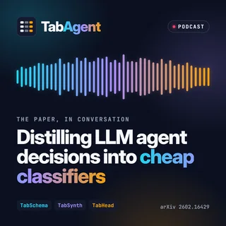
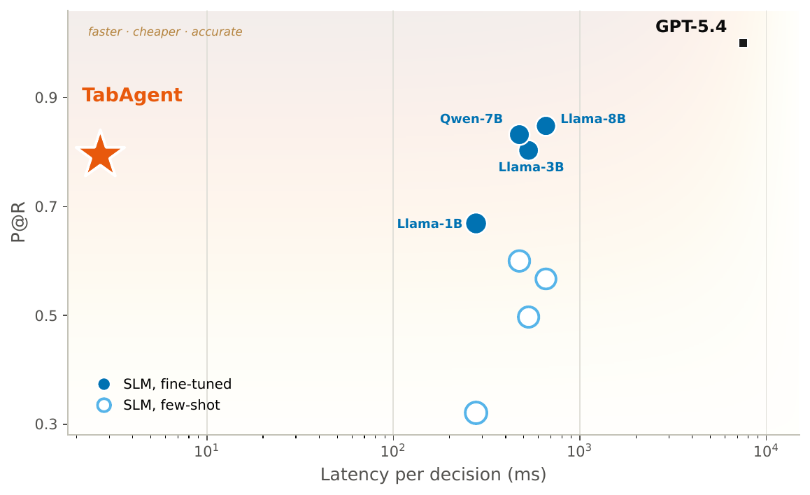
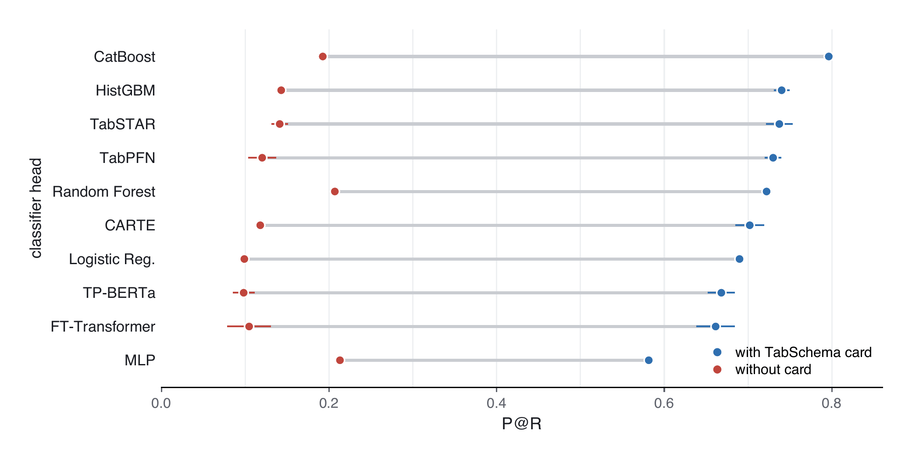
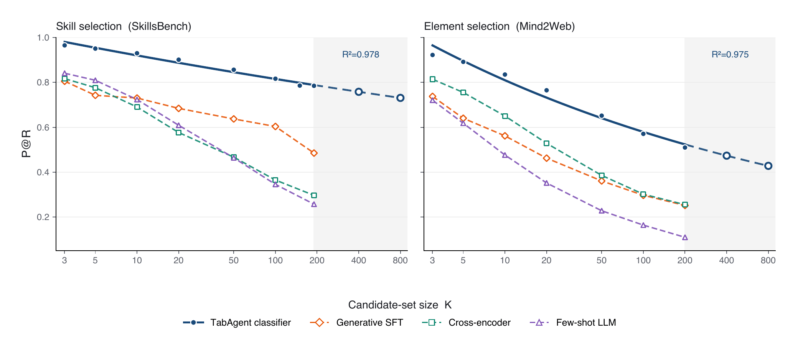

<div align="center">

<picture>
  <source media="(prefers-color-scheme: dark)" srcset="docs/assets/brand/wordmark-dark.svg">
  
</picture>

### Replace an LLM agent's closed-set decisions with a cheap classifier trained from its own logs.

<!-- named -->
**TabAgent: Distilling LLM Agent Components into Cheap Classifiers**<br>
<sub>Ido Levy<sup>1,2</sup> · Segev Shlomov<sup>1</sup> · Avi Yaeli<sup>1</sup> · Nir Mashkif<sup>1</sup> · Asaf Adi<sup>1</sup> · Yinon Goldstein<sup>1</sup> · Eilam Shapira<sup>1</sup> · Leshem Choshen<sup>1,2</sup></sub><br>
<sub><sup>1</sup>IBM · <sup>2</sup>Weizmann Institute of Science</sub>

<p>
  <a href="https://arxiv.org/abs/2602.16429"></a>
  <a href="https://doi.org/10.5281/zenodo.23552568"></a>
  <a href="https://dolev31.github.io/TabAgent/"></a>
  <a href="https://colab.research.google.com/github/dolev31/TabAgent/blob/main/notebooks/quickstart.ipynb"></a>
  <a href="https://huggingface.co/dolev31/tabagent-skillsbench-skill-selection"></a>
  <br>
  <a href="https://pypi.org/project/tabagent/"></a>
  <a href="pyproject.toml"></a>
  <a href="https://github.com/dolev31/TabAgent/actions/workflows/ci.yml"></a>
  <a href="LICENSE"></a>
</p>
<!-- /named -->

<!-- named -->
<a href="https://dolev31.github.io/TabAgent/#explainer"></a>
<sub>▶ <a href="https://dolev31.github.io/TabAgent/#explainer"><b>Watch the full 73-second explainer, with captions</b></a></sub>
<!-- /named -->

<!-- named -->
<table>
  <tr>
    <td width="132" valign="middle">
      <a href="https://dolev31.github.io/TabAgent/#podcast"></a>
    </td>
    <td valign="middle">
      <sub><b>PODCAST</b> · 23 min</sub><br>
      <b><a href="https://dolev31.github.io/TabAgent/#podcast">Distilling LLM Agent Decisions into Cheap Classifiers</a></b><br>
      <sub>The paper in conversation: the problem, the three phases, the results, the honest limits and how to start.</sub><br>
      <a href="https://dolev31.github.io/TabAgent/#podcast"></a>
      <a href="https://dolev31.github.io/TabAgent/podcast/transcript/"></a>
    </td>
  </tr>
</table>
<!-- /named -->

**[Quick start](#quick-start)** · **[How it works](#how-it-works)** · **[Results](#results)** · **[Use it in your agent](#use-it-in-your-agent)** · **[Docs](https://dolev31.github.io/TabAgent/)** · **[Contribute](#contribute)** · **[Cite](#citation)**

</div>

## Why

- **Agents pay a frontier LLM for the same kind of decision again and again.** Which tools to shortlist, which skill
  or application to use, which model or sub-agent to route to: closed-set decisions whose repeated calls dominate
  per-task latency and cost.
- **A classifier trained on the agent's own successful runs can make them instead.** On AppWorld tool shortlisting it
  recovers essentially all of the tools the GPT-5.4 shortlister used on its successful runs (Recall@9 of 92–100), in
  **2.682 ms for $2.0×10⁻⁷** per decision against 7.50 s and $0.052: more than 10³× lower latency and 10⁵× lower
  cost.
- **The representation does the work, not the model.** A head over raw text or embeddings alone collapses;
  trace-derived features make it accurate, so one lightweight CatBoost head serves every decision family.

## How it works

<p align="center">
  <picture>
    <source media="(prefers-reduced-motion: reduce)" srcset="docs/assets/pipeline.svg">
    
  </picture>
</p>

| | |
|---|---|
|  | **Discovers features.** LLM agents analyze the successful trajectories, write and sandbox-test the extraction code, and a judge ensemble keeps the features that matter. |
|  | **Augments the rows.** Deterministic, label-preserving paraphrases of the free-text state, where trajectories are scarce. |
|  | **Decides in milliseconds.** A CatBoost classifier scores every candidate in one pass; a confidence gate can defer unsure decisions back to the LLM. |

The three phases run once per agent and catalog. At inference the head replaces the LLM call, and the rest of the
agent is unchanged. [The three phases](docs/concepts/three-phases.md) covers each phase in detail.

## Quick start

```bash
pip install tabagent
```

**See it work** on a public benchmark, in a few minutes on a laptop CPU (it downloads 3.5 MB of data and a 128 MB
encoder once):

```bash
git clone https://github.com/dolev31/TabAgent && cd TabAgent
pip install -e ".[embed]"
python examples/01_quickstart_skillsbench.py   # P@R ≈ 0.80, Recall@9 ≈ 0.90 on SkillsBench skill selection
```

The paper reports P@R 80 and Recall@9 91 there; [Reproducing the paper](docs/reproducing.md) compares every public
result with the paper's.

<details>
<summary><b>Extras and the other examples</b></summary>

```bash
pip install "tabagent[tabschema]"   # onboarding from agent logs (OpenAI and OpenAI-compatible LLMs)
pip install "tabagent[llm]"         # Anthropic, Gemini and other providers through LiteLLM
pip install "tabagent[embed]"       # e5 context-candidate similarity features
pip install "tabagent[serve]"       # the HTTP decision service
```

| Example | What it shows | Needs |
|---|---|---|
| [01_quickstart_skillsbench.py](examples/01_quickstart_skillsbench.py) | the paper's components on a public benchmark, cross-validated | CPU; network on first run |
| [02_bring_your_own_table.py](examples/02_bring_your_own_table.py) | scikit-learn estimators on your own decision table | CPU, offline |
| [03_onboard_agent_logs.py](examples/03_onboard_agent_logs.py) | onboarding a decision from your own agent logs | an LLM API key |
| [04_deploy.py](examples/04_deploy.py) | live decisions in-process, the HTTP service, a tool filter in front of your LLM | a saved head |
| [05_tau2_cross_agent_transfer.py](examples/05_tau2_cross_agent_transfer.py) | training on one agent's traces and deploying on another's | CPU; network on first run |

For the exact dependency versions pinned in `uv.lock`, clone the repository and run `uv sync --extra embed`.
</details>

## Results

| Decision | Benchmark | Metric | Best baseline | **TabAgent** |
|---|---|---|---:|---:|
| Tool shortlisting | AppWorld, five apps | P@R | 56–92 | **66–96** |
| Tool shortlisting | τ²-bench, three domains, 38 tools | P@R | 42 | **78** |
| Skill shortlisting | SkillsBench, 195 skills | P@R | 74 | **80** |
| Application selection | AppWorld, multi-label | macro-F1 | 92 | **97** |
| Operation selection | Mind2Web, three-way | macro-F1 | 84 | **92** |
| GUI element selection | Mind2Web, three domains | R@3 | 15–23 | **68–74** |
| Model routing | LLMRouterBench, 12 models | route@1 | 70 | **71** (on par) |

<details>
<summary><b>How to read this table, and what is reproducible here</b></summary>

Percentages from the paper's Table 1 and, for AppWorld, its full per-method table. TabAgent is the better of its
real-only and +synth variants. Best baseline is the strongest of BM25, DSR (zero-shot and fine-tuned; on AppWorld also
fine-tuned on the same TabSynth rows, where TabAgent's lead is significant only on Gmail) and the few-shot LLM in each
row; on model routing it is the best single model applied to every task. A fine-tuned 8B small LLM, a reference at
about 10²–10⁴× TabAgent's cost, is excluded as in the paper; it scores higher on four of the five AppWorld apps. The
paper's table also covers the OAK and BPO enterprise benchmarks, where the small trajectory pools leave TabAgent behind
or level with the best baseline, and sub-agent routing and skill gating, where it is on par with the best fixed default.

The AppWorld rows use the CUGA agent's own trajectories, which are not released. Every other row is recomputed by
[Reproducing the paper](docs/reproducing.md) from public data, on the feature cards bundled with each dataset, so it
calls no LLM. The released TabSchema implementation has not yet been validated against a paper number.
</details>

<p align="center">
  
  <br><sub><em>AppWorld tool shortlisting: TabAgent (star) is the fastest, cheapest point, near the top on quality.</em></sub>
</p>

<details>
<summary><b>More findings</b></summary>

- **In the loop.** Hot-swapped into a live agent on 24 held-out AppWorld tasks, TabAgent reaches 27.1% task success
  against 29.2% for the GPT-5.4 shortlister; the paired 95% CI of the difference, [−18.8, +16.7], includes zero.
- **Few traces.** The head reaches 90% of its full-pool P@R from 118 successful trajectories on AppWorld and from
  37 to 51 on the four τ²-bench agents.
- **Across agents.** Trained on one ReAct agent's traces and tested on another's, it loses about 3.1 points of P@R on
  τ²-bench (transfer within one architecture).
- **The head barely matters.** Every classifier head reaches useful P@R with the feature card and collapses to
  0.10–0.21 without it; as the candidate set grows, LLM regimes degrade sharply while TabAgent stays highest.



</details>

## Reproduce the paper

Every public result has one command; `make reproduce` runs every public Table 1 and Table 2 cell on a CPU.

| Paper result | Command | Runs on |
|---|---|---|
| Table 1, τ²-bench rows | `python -m experiments.reproduce --cells tau2-airline tau2-retail tau2-telecom tau2-combined` | CPU, 25 min |
| Table 1, skill selection | `python -m experiments.reproduce --cells skill-selection` | CPU, 2 min |
| Table 1, Mind2Web operation and element selection | `python -m experiments.reproduce --cells operation-selection element-selection` | CPU, 5.9 GB of data |
| Table 2, transfer across agents | `python -m experiments.reproduce --cells transfer` | CPU, 5 min |
| Fig. 3, classifier heads | `python -m experiments.figures.head_ablation` | CPU, 1 hour |
| Table 15 and Fig. 4, cost and the Pareto plot | `python -m experiments.efficiency.cost` and `python -m experiments.efficiency.pareto --paper` | CPU, seconds |

[Reproducing the paper](docs/reproducing.md) lists every table and figure with its command, time and data, puts
the released numbers next to the paper's, and names what public data cannot reproduce (the results on the CUGA
agent's AppWorld trajectories).

## Use it in your agent

**1. Onboard** a decision from the agent's own logs (OpenAI, Anthropic, LangChain, τ²-bench, CUGA or generic JSON):

```bash
export OPENAI_API_KEY=...                                          # the LLM TabSchema calls
tabagent scan ./agent_logs                                         # which LLM calls are worth replacing?
tabagent onboard ./agent_logs --decision ToolShortlist --dry-run   # what it will process and cost
tabagent onboard ./agent_logs --decision ToolShortlist --out ./my_head
```

**2. Serve** it: `tabagent serve ./my_head --port 8077` answers `POST /decide` from warm, sandboxed workers, with
readiness, Prometheus metrics and drift monitoring ([production runbook](docs/guides/production-runbook.md)).

**3. Hot-swap** the LLM call: `ToolFilter` sends your tool-calling LLM only the tools the head shortlists, and the full
list whenever the head defers.

```python
from tabagent.integrations.openai_tools import ToolFilter

tool_filter = ToolFilter("my_head", k=7)  # or the URL of a `tabagent serve` service
session = tool_filter.session(task={"instruction": goal})  # one per conversation
client.chat.completions.create(model=..., messages=messages, tools=session(messages, tools))
```

<details>
<summary><b>Python API and scikit-learn estimators</b></summary>

```python
import tabagent

head = tabagent.onboard("./agent_logs", decision="ToolShortlist")
print(head.report)  # grouped cross-validation vs BM25 and chance, latency, cost per decision
head.save("my_head")
head.decide(prefix, candidates, k=5)  # {"candidates", "scores", "confidence", "deferred", "error"}
```

```python
from tabagent import TabAgentRanker

# one row per (decision, candidate); y = 1 if the agent chose the candidate
ranker = TabAgentRanker(group_col="task_id", candidate_col="tool")
ranker.fit(X, y)  # infers the card, picks TabSynth and the prior by nested validation
ranker.rank(X_new, k=5)  # top-5 candidates per decision
```

Onboarding sends trajectories to your LLM provider; `redact=` (CLI: `--redact module:function`) scrubs them first.
</details>

## Documentation

[Get started](docs/get-started/index.md) · [Guides](docs/guides/index.md) · [Concepts](docs/concepts/index.md) ·
[API reference](docs/reference/index.md) · [Command line](https://dolev31.github.io/TabAgent/reference/cli/) · [Datasets](docs/datasets.md) ·
[Reproducing the paper](docs/reproducing.md)

<!-- named -->
The guides are also a searchable site at [dolev31.github.io/TabAgent](https://dolev31.github.io/TabAgent/). Pretrained
heads for [SkillsBench skill selection](https://huggingface.co/dolev31/tabagent-skillsbench-skill-selection) and
[τ²-bench tool shortlisting](https://huggingface.co/dolev31/tabagent-tau2-tool-shortlisting) load with
`tabagent.load("hf://...")`, and the [Colab quickstart](https://colab.research.google.com/github/dolev31/TabAgent/blob/main/notebooks/quickstart.ipynb) runs one in the browser.
<!-- /named -->

## Contribute

TabAgent is young, and three areas would benefit most from your help. Each track lists tasks that name the file to
start in and the test that says they are done; the [roadmap](https://github.com/dolev31/TabAgent/discussions/13) is
the place to ask.

| | Track | Start with |
|---|---|---|
| 🔍 | [**Find the bottleneck**](https://github.com/dolev31/TabAgent/issues/10): which LLM call in an agent is worth replacing | [OpenTelemetry traces](https://github.com/dolev31/TabAgent/issues/1) · [LangSmith/Langfuse](https://github.com/dolev31/TabAgent/issues/2) |
| 🔁 | [**Smoother hot swap**](https://github.com/dolev31/TabAgent/issues/11): from a trained head to production, safely | [LangGraph example](https://github.com/dolev31/TabAgent/issues/4) · [shadow mode](https://github.com/dolev31/TabAgent/issues/5) |
| 🧩 | [**A better feature card**](https://github.com/dolev31/TabAgent/issues/12): what the classifier looks at | [candidate recency](https://github.com/dolev31/TabAgent/issues/7) · [`card explain`](https://github.com/dolev31/TabAgent/issues/8) |

Every pull request meets [one published bar](CONTRIBUTING.md#the-bar): tested, documented and typed, small enough to
review, checked automatically, and reviewed against a rubric. `make pr-ready` runs every check locally. AI tools and
coding agents are welcome; a person stays accountable for every line.

<!-- named -->
## Citation

If TabAgent or its pretrained heads help your work, please cite the paper. `tabagent cite` prints this entry
(`--format apa` for APA), and GitHub's "Cite this repository" button reads [CITATION.cff](CITATION.cff). Each
release of the code is archived on Zenodo, [doi:10.5281/zenodo.23552568](https://doi.org/10.5281/zenodo.23552568) (all versions).

```bibtex
@misc{levy2026tabagent,
  title  = {TabAgent: Distilling LLM Agent Components into Cheap Classifiers},
  author = {Levy, Ido and Shlomov, Segev and Yaeli, Avi and Mashkif, Nir and Adi, Asaf and
            Goldstein, Yinon and Shapira, Eilam and Choshen, Leshem},
  year   = {2026},
  eprint = {2602.16429},
  archivePrefix = {arXiv},
  primaryClass  = {cs.CL},
  doi    = {10.48550/arXiv.2602.16429},
  url    = {https://arxiv.org/abs/2602.16429}
}
```

<!-- /named -->
## License

Apache-2.0 (see [LICENSE](LICENSE)). TabAgent ships no benchmark data and no agent trajectories; the benchmarks keep
their own licenses, listed in [NOTICE](NOTICE). Contributions are welcome: see [CONTRIBUTING.md](CONTRIBUTING.md) and the
[Code of Conduct](CODE_OF_CONDUCT.md); [SECURITY.md](SECURITY.md) covers how generated extraction code is sandboxed and
how to report a vulnerability privately.

## Acknowledgements

The public results are recomputed from the benchmarks' own releases, downloaded at pinned revisions and verified by
SHA-256: [τ²-bench](https://github.com/sierra-research/tau2-bench) and the
[tau2-sft-final](https://huggingface.co/datasets/Jarrodbarnes/tau2-sft-final) trajectories,
[SkillsBench](https://github.com/benchflow-ai/skillsbench), [Mind2Web](https://huggingface.co/datasets/osunlp/Mind2Web)
(CC-BY-4.0), [LLMRouterBench](https://huggingface.co/datasets/NPULH/LLMRouterBench) and
[AppWorld](https://github.com/StonyBrookNLP/appworld). The paper also evaluates on AppWorld with the
[CUGA](https://github.com/cuga-project/cuga-agent) agent and on the OAK and BPO benchmarks. TabHead is built on
[CatBoost](https://catboost.ai), the similarity features on [e5-small-v2](https://huggingface.co/intfloat/e5-small-v2),
and the brand type is [Inter](https://rsms.me/inter/) and [JetBrains Mono](https://www.jetbrains.com/lp/mono/)
(SIL OFL 1.1).
