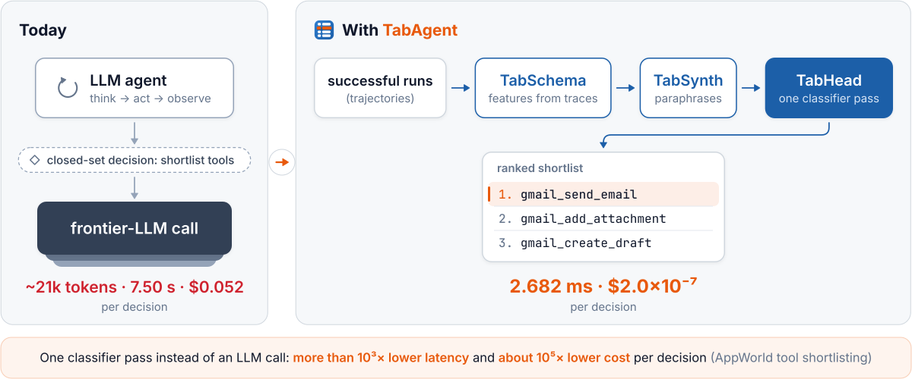

<div align="center">

<h1>
  <picture>
    <source media="(prefers-color-scheme: dark)" srcset="docs/assets/brand/wordmark-dark.svg">
    
  </picture>
</h1>

<h3>Distilling LLM Agent Components into Cheap Classifiers</h3>

**Replace an LLM agent's repeated closed-set decisions with a cheap classifier trained on the agent's own
successful runs.**

<!-- named -->
Ido Levy<sup>1,2</sup> · Segev Shlomov<sup>1</sup> · Avi Yaeli<sup>1</sup> · Nir Mashkif<sup>1</sup> · Asaf Adi<sup>1</sup> ·
Yinon Goldstein<sup>1</sup> · Eilam Shapira<sup>1</sup> · Leshem Choshen<sup>1,2</sup>

<sup>1</sup>IBM · <sup>2</sup>Weizmann Institute of Science

[](https://arxiv.org/abs/2602.16429)
[](https://dolev31.github.io/TabAgent/)
[](https://github.com/dolev31/TabAgent/actions/workflows/ci.yml)
[](pyproject.toml)
[](LICENSE)
[](https://github.com/astral-sh/ruff)
<!-- /named -->

[Quickstart](#quickstart) · [Results](#results-at-a-glance) · [How it works](#how-it-works) ·
[Use it on your agent](#three-ways-to-use-it) · [Reproduce the paper](docs/reproducing.md) ·
[Documentation](#documentation)

</div>

<p align="center">
  <picture>
    <source media="(prefers-color-scheme: dark)" srcset="docs/assets/brand/hero-dark.svg">
    
  </picture>
</p>

## Why TabAgent

Agents call a frontier LLM again and again for decisions whose answer comes from a fixed set: which tools to
shortlist, which skill or application to use, which model or sub-agent to route to, whether to activate a
skill. TabAgent learns those decisions from the agent's execution traces and serves them from a tabular
classifier, with the surrounding agent left unchanged.

| AppWorld tool shortlisting, per decision | GPT-5.4 shortlister | TabAgent head |
|---|---|---|
| latency | 7.50 s | **2.682 ms** (more than 10³× lower) |
| cost | $0.052 | **$2.0×10⁻⁷** (about 10⁵× lower) |
| quality | the reference | recovers essentially all of the tools the shortlister used on its successful runs (Recall@9) |

<p align="center">
  
  <br>
  <sub><em>Per-decision latency (x, log ms) against shortlisting quality P@R (y) on AppWorld. TabAgent (star) is the
  fastest and cheapest point while remaining near the top on quality; filled circles are fine-tuned small LLMs,
  open circles the same models few-shot. Figure from the paper.</em></sub>
</p>

What the paper finds, across three decision families and seven agent benchmarks:

- **Set retrieval.** On AppWorld tool shortlisting, TabAgent recovers essentially all of the tools the GPT-5.4
  shortlister used on its successful runs (Recall@9) at far lower latency and cost.
- **Classification and policy.** It ranks first on the classification decisions and is on par with a strong
  fixed default on the harder routing and gating decisions, where a costly generative router does worse.
- **Representation, not model.** A discriminative head over raw text or embeddings alone collapses; the
  trace-derived features make it accurate.
- **In the loop.** Placed on a live agent's critical path, TabAgent drives AppWorld tasks to completion about
  as often as the GPT-5.4 shortlister it replaces.
- **Few traces.** The head reaches 90% of its full-pool P@R from 118 successful trajectories on AppWorld and
  from 37 to 51 on the four τ²-bench agents.

## Results at a glance

| Decision | Benchmark | Metric | Best baseline | TabAgent | Reproducible here |
|---|---|---|---:|---:|:---:|
| Tool shortlisting | AppWorld, five apps | P@R | 56–92 | **66–96** | traces not released |
| Tool shortlisting | τ²-bench, three domains, 38 tools | P@R | 42 | **78** | ✓ |
| Skill shortlisting | SkillsBench, 195 skills | P@R | 74 | **80** | ✓ |
| Application selection | AppWorld, multi-label | macro&#8209;F1 | 92 | **97** | traces not released |
| Operation selection | Mind2Web, three-way | macro&#8209;F1 | 84 | **92** | ✓ |
| GUI element selection | Mind2Web, three domains | R@3 | 15–23 | **68–74** | ✓ |
| Model routing | LLMRouterBench, 12 models | route@1 | 70 | **71**&nbsp;(on&nbsp;par) | ✓ opt-in download |

<sub>Percentages from the paper's Table 1 and, for AppWorld, its full per-method table. TabAgent is the better of
its real-only and +synth variants. Best baseline is the strongest of BM25, DSR (zero-shot and fine-tuned; on
AppWorld also fine-tuned on the same TabSynth rows, where TabAgent's lead is significant only on Gmail) and the
few-shot LLM in each row; on model routing it is the best single model applied to every task. A fine-tuned 8B small LLM, a reference at about
10²–10⁴× TabAgent's cost, is excluded as in the paper; it scores higher on four of the five AppWorld apps. The
AppWorld rows use the CUGA agent's own trajectories, which are not released. The paper's table also covers the
OAK and BPO enterprise benchmarks, where the small trajectory pools leave TabAgent behind or level with the best
baseline, and sub-agent routing and skill gating, where it is on par with the best fixed default. [Reproducing the paper](docs/reproducing.md) recomputes every public row.</sub>

<table>
  <tr>
    <td width="50%" valign="top">
      
      <br>
      <sub><b>The features carry the decision, not the head.</b> Every classifier head, from trees to tabular
      foundation models, reaches useful P@R with the TabSchema card (blue) and collapses to 0.10–0.21 without it
      (red). Skill selection, means of 3 seeds.</sub>
    </td>
    <td width="50%" valign="top">
      
      <br>
      <sub><b>Resilient to candidate overload.</b> As the candidate set grows, every LLM adaptation regime
      (generative SFT, cross-encoder, few-shot) degrades sharply, while the TabAgent classifier follows a shallow
      power law (R² ≥ 0.97) and stays highest at every measured size.</sub>
    </td>
  </tr>
</table>

## How it works

1. **TabSchema** reads your agent's own logs and, with an LLM, proposes behavior-grounded features, writes and
   sandbox-tests the code that extracts them, and keeps only those a judge ensemble accepts. The output is a
   *feature card* plus a reusable, reviewed extractor. It runs once per agent and catalog.
2. **TabSynth** adds deterministic, label-preserving paraphrases of the free-text state where trajectories are
   scarce.
3. **TabHead** scores every candidate of a decision in one pass (CatBoost), with an optional confidence gate that
   defers uncertain decisions back to the original LLM.

<p align="center">
  
  <br><sub><em>TabSchema compiles trajectory-derived schema, state, and dependency signals into tabular features.</em></sub>
</p>
<p align="center">
  
  <br><sub><em>TabHead consumes features and candidates to output per-candidate probabilities.</em></sub>
</p>

## Install

```bash
pip install tabagent                    # core: tables, TabSynth, TabHead, evaluation
# until the PyPI release: pip install "tabagent @ git+https://github.com/dolev31/TabAgent"
pip install "tabagent[tabschema]"       # + onboarding from agent logs (OpenAI-compatible LLM client)
pip install "tabagent[embed]"           # + e5 context-candidate similarity features
pip install "tabagent[serve]"           # + HTTP decision service
```

`pip` resolves the newest dependency releases. For the exact versions pinned in `uv.lock`, clone the
repository and run `uv sync --extra embed`.

## Quickstart

```bash
git clone https://github.com/dolev31/TabAgent && cd TabAgent
pip install -e ".[embed]"
python examples/01_quickstart_skillsbench.py
```

The first run downloads the pinned SkillsBench release (3.5 MB, SHA-256 verified) and the e5-small-v2 encoder
from Hugging Face (about 128 MB), then runs the paper's five-fold task-level cross-validation on CPU (about
ten minutes on a laptop). It prints P@R ≈ 0.80 and Recall@9 ≈ 0.90 with 95% bootstrap intervals, then the
five skills TabAgent would hand the agent for a held-out task. The paper reports P@R 80 and Recall@9 91;
[docs/reproducing.md](docs/reproducing.md) compares every reproducible cell with the paper's.

| Example | What it shows | Needs |
|---|---|---|
| [01_quickstart_skillsbench.py](examples/01_quickstart_skillsbench.py) | the paper's components on a public benchmark, cross-validated | CPU; network on first run (3.5 MB of data, 128 MB encoder) |
| [02_bring_your_own_table.py](examples/02_bring_your_own_table.py) | scikit-learn estimators on your own decision table | CPU, offline |
| [03_onboard_agent_logs.py](examples/03_onboard_agent_logs.py) | onboarding a decision from your own agent logs | an LLM API key |
| [04_deploy.py](examples/04_deploy.py) | live decisions in-process, the HTTP service, a tool filter in front of your LLM | a saved head (from 02 or 03) |
| [05_tau2_cross_agent_transfer.py](examples/05_tau2_cross_agent_transfer.py) | training on one agent's traces and deploying on another's (paper Table 2) | CPU; network on first run (about 600 MB) |

## Three ways to use it

### 1. You have agent logs and an LLM key

```bash
export OPENAI_API_KEY=...        # or OPENAI_BASE_URL for any OpenAI-compatible server, or ANTHROPIC/GEMINI keys
tabagent components ./agent_logs                              # which decisions can be replaced?
tabagent onboard ./agent_logs --decision ToolShortlist --dry-run   # what it will process and cost
tabagent onboard ./agent_logs --decision ToolShortlist --out ./my_head
tabagent serve ./my_head --port 8077
```

```python
import tabagent

head = tabagent.onboard("./agent_logs", decision="ToolShortlist")  # a budget: max_cost_usd= with prices=
print(head.report)  # grouped cross-validation vs BM25 and chance, latency, cost per decision
head.save("my_head")
head.decide(prefix, candidates, k=5)  # {"candidates", "scores", "confidence", "deferred"}
```

Supported log formats are detected automatically: OpenAI / Anthropic / LangChain tool-call message logs,
τ²-bench results, CUGA trajectories, and generic JSON with a `steps` list. Trajectories are sent to your LLM
provider during onboarding; pass `redact=` to scrub them first.

### 2. You have a table of decisions (scikit-learn API)

```python
from sklearn.model_selection import GroupKFold, cross_val_score
import tabagent
from tabagent import TabAgentRanker

# one row per (decision, candidate); y = 1 if the agent chose the candidate
ranker = TabAgentRanker(group_col="task_id", candidate_col="tool")
ranker.fit(X, y)  # infers the card, picks TabSynth and the prior by nested validation
ranker.rank(X_new, k=5)  # top-5 candidates per decision
cross_val_score(ranker, X, y, groups=X.task_id, cv=GroupKFold(5), scoring=tabagent.scorer("p@r"))
print(ranker.report(X, y))
```

`TabAgentClassifier` handles single-label decisions, `TabAgentRouter` handles routing (pick the arm with the
highest predicted success). `tabagent.pointwise()` turns one-row-per-decision logs into this layout.

### 3. Full control: the paper's components

```python
from tabagent import FeatureCard, TabAgent, TabHead, TabSynth, cross_validate, datasets

table = datasets.load("skillsbench/skill-select", download=True)  # rebuilt from the pinned public release
card = datasets.card("skillsbench/skill-select")
agent = TabAgent(card, head=TabHead("ranking"), synth=TabSynth(k=2))
res = cross_validate(agent, table, folds=datasets.folds("skillsbench/skill-select"))
print(res.summary(["p@r", "recall@9"]))
```

## Reproducing the paper

The release reproduces the following from public data: τ²-bench (cross-backbone transfer and per-domain
shortlisting), SkillsBench (skill selection and gating), Mind2Web (operation and element selection),
LLMRouterBench (model routing; MIT as declared upstream, opt-in download) and AppWorld sub-agent routing (data obtained
through AppWorld's official CLI). See [docs/reproducing.md](docs/reproducing.md) for each paper cell, the command
that recomputes it, and the value it produces. The AppWorld tool-shortlisting results and the in-loop hot swap
use the CUGA agent's own trajectories, which are not released; the CUGA trajectory adapter is included, so the
pipeline can be rerun on your own CUGA traces. The OAK and BPO benchmarks are public; loaders for them are not
included yet.

## Documentation

| Guide | Covers |
|---|---|
| [Concepts](docs/concepts.md) | the decision table, the four decision kinds, leakage safety, the evaluation protocol |
| [Components](docs/components.md) | TabSchema, TabSynth and TabHead in detail |
| [Onboard an agent](docs/onboarding.md) | log formats, privacy and cost controls, reviewing the generated extractor |
| [Bring your own table](docs/bring_your_own_data.md) | the scikit-learn estimators and automatic recipe selection |
| [Deploy](docs/deployment.md) | saved heads, the HTTP service, the tool filter, the confidence gate |
| [Datasets](docs/datasets.md) | every public dataset, its pinned source, license and the paper result it backs |
| [Reproducing the paper](docs/reproducing.md) | each paper cell, the command that recomputes it, paper vs released values |

<!-- named -->
The guides are also published as a searchable site at [dolev31.github.io/TabAgent](https://dolev31.github.io/TabAgent/).
<!-- /named -->
`make docs` builds the same site locally (mkdocs-material).
<!-- named -->
Pretrained heads for [SkillsBench skill selection](https://huggingface.co/dolev31/tabagent-skillsbench-skill-selection) and [τ²-bench tool shortlisting](https://huggingface.co/dolev31/tabagent-tau2-tool-shortlisting) load with `tabagent.load("hf://...")`, and a [demo Space](https://huggingface.co/spaces/dolev31/tabagent-skill-shortlisting) runs one live ([Deploy](docs/deployment.md#pretrained-heads-and-the-demo)).
<!-- /named -->

## Data policy

TabAgent ships no benchmark data and no agent trajectories. Public datasets are downloaded from their upstream
releases at pinned revisions and verified by SHA-256; licenses are listed in [NOTICE](NOTICE).

## Contributing

Issues and pull requests are welcome: new agent log formats, decision kinds, classifier heads and benchmark
loaders (the public OAK and BPO benchmarks are next). See [CONTRIBUTING.md](CONTRIBUTING.md) for the setup and
the checks, and [SECURITY.md](SECURITY.md) for how generated extraction code is sandboxed.

<!-- named -->
## Citation

If you use TabAgent, please cite the paper:

```bibtex
@misc{levy2026tabagent,
  title  = {TabAgent: Distilling LLM Agent Components into Cheap Classifiers},
  author = {Levy, Ido and Shlomov, Segev and Yaeli, Avi and Mashkif, Nir and Adi, Asaf and
            Goldstein, Yinon and Shapira, Eilam and Choshen, Leshem},
  year   = {2026},
  eprint = {2602.16429},
  archivePrefix = {arXiv},
  primaryClass  = {cs.CL},
  url    = {https://arxiv.org/abs/2602.16429}
}
```

<!-- /named -->
## License

Apache-2.0 (see [LICENSE](LICENSE)). The benchmarks keep their own licenses, listed in [NOTICE](NOTICE).
