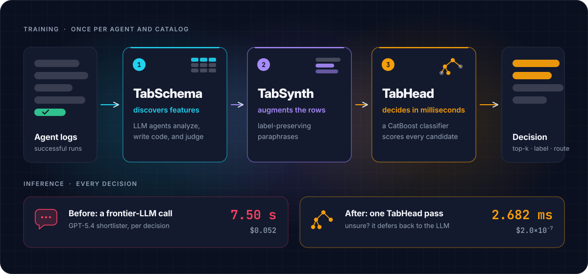

# Concepts

-   :material-layers-triple-outline: [__The three phases__](three-phases.md)

    TabSchema discovers features, TabSynth adds label-preserving paraphrases, TabHead scores every candidate in one pass.

-   :material-shape-outline: [__Decision kinds__](decision-kinds.md)

    Ranking, multi-label, single-class and policy decisions as one pointwise table, and how each is scored.

-   :material-table-column-plus-after: [__Per-candidate features__](per-candidate-features.md)

    Features that relate the context to a candidate, relative features, dependency features and the public evidence.

-   :material-lock-check-outline: [__Leakage safety__](leakage-safety.md)

    Every data-dependent stage is fitted inside the training fold. How that is enforced and where it is not.

-   :material-gate: [__The confidence gate__](confidence-gate.md)

    Defer unsure decisions to the original LLM, and calibrate the threshold.

## The whole system on one page

<figure class="ta-figure" markdown="span">
  { loading=lazy }
</figure>

The three phases run once per agent and catalog. At inference the head replaces the LLM call, and the rest of the
agent is unchanged. The numbers behind the idea are on the [home page](../index.md#results-at-a-glance) and in
[Reproduce the paper](../reproducing.md).
