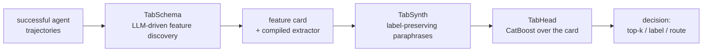
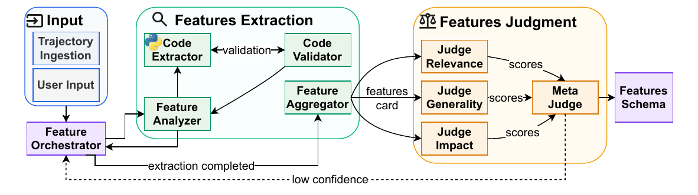
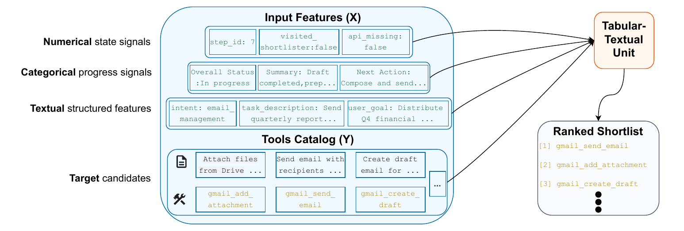

---
hide:
  - navigation
  - toc
---

<div class="ta-hero" markdown>

<h1 class="ta-hero__title" id="tabagent" markdown> </h1>

<p class="ta-hero__tagline">Replace an LLM agent's repeated <span class="ta-nowrap">closed-set</span> decisions with a cheap classifier trained on the agent's own successful runs.</p>

<p class="ta-hero__paper" markdown>Code for the paper *TabAgent: Distilling LLM Agent Components into Cheap Classifiers*.</p>

<!-- named -->
<p class="ta-hero__authors">Ido&nbsp;Levy<sup>1,2</sup>&nbsp;· Segev&nbsp;Shlomov<sup>1</sup>&nbsp;· Avi&nbsp;Yaeli<sup>1</sup>&nbsp;· Nir&nbsp;Mashkif<sup>1</sup>&nbsp;· Asaf&nbsp;Adi<sup>1</sup>&nbsp;· Yinon&nbsp;Goldstein<sup>1</sup>&nbsp;· Eilam&nbsp;Shapira<sup>1</sup>&nbsp;· Leshem&nbsp;Choshen<sup>1,2</sup></p>
<p class="ta-hero__authors"><sup>1</sup>IBM&nbsp;· <sup>2</sup>Weizmann&nbsp;Institute&nbsp;of&nbsp;Science</p>
<!-- /named -->

<div class="ta-hero__actions" markdown>

[Get started :material-arrow-right:](bring_your_own_data.md){ .md-button .md-button--primary }
[Onboard an agent](onboarding.md){ .md-button }
[Reproduce the paper](reproducing.md){ .md-button }

</div>

<div class="ta-hero__art" markdown>


</div>

</div>

<div class="ta-stats">
  <div class="ta-stat">
    <div class="ta-stat__label">Latency per decision</div>
    <div class="ta-stat__value">2.682 ms</div>
    <div class="ta-stat__compare">vs 7.50 s per decision for the GPT-5.4 shortlister</div>
  </div>
  <div class="ta-stat">
    <div class="ta-stat__label">Cost per decision</div>
    <div class="ta-stat__value">$2.0×10⁻⁷</div>
    <div class="ta-stat__compare">vs $0.052 per decision for the GPT-5.4 shortlister</div>
  </div>
  <div class="ta-stat">
    <div class="ta-stat__label">Recall@9</div>
    <div class="ta-stat__value">92–100</div>
    <div class="ta-stat__compare">of the tools the GPT-5.4 shortlister used on its successful runs</div>
  </div>
</div>
<p class="ta-stats__caption">AppWorld tool shortlisting: TabAgent's head against the GPT-5.4 shortlister it replaces.</p>

Agents call a frontier LLM again and again for decisions whose answer comes from a fixed set: which tools to
shortlist, which skill or application to use, which model or sub-agent to route to, whether to activate a
skill. TabAgent learns those decisions from the agent's execution traces and serves them from a tabular
classifier, with the surrounding agent left unchanged.
{ .ta-lead }

## Guides

<div class="grid cards ta-guides" markdown>

-   :material-lightbulb-on-outline: [Concepts](concepts.md)

    The decision table, the four decision kinds, leakage safety, the evaluation protocol.

-   :material-puzzle-outline: [Components](components.md)

    TabSchema, TabSynth and TabHead in detail.

-   :material-robot-outline: [Onboard an agent](onboarding.md)

    Log formats, privacy and cost controls, reviewing the generated extractor.

-   :material-table-large: [Bring your own table](bring_your_own_data.md)

    The scikit-learn estimators and automatic recipe selection.

-   :material-rocket-launch-outline: [Deploy](deployment.md)

    Saved heads, the HTTP service, the tool filter, the confidence gate.

-   :material-database-outline: [Datasets](datasets.md)

    Every public dataset, its pinned source, license and the paper result it backs.

-   :material-flask-outline: [Reproducing the paper](reproducing.md)

    Each paper cell, the command that recomputes it, paper vs released values.

-   :material-code-braces: [Examples](#try-it)

    Five runnable scripts, from the public-benchmark quickstart to cross-agent transfer.

</div>

## How it works

<div class="ta-diagram" markdown>



</div>

<div class="ta-steps" markdown>

1. **TabSchema** reads your agent's own logs and, with an LLM, proposes behavior-grounded features, writes and
   sandbox-tests the code that extracts them, and keeps only those a judge ensemble accepts. The output is a
   *feature card* plus a reusable, reviewed extractor. It runs once per agent and catalog.
2. **TabSynth** adds deterministic, label-preserving paraphrases of the free-text state where trajectories are
   scarce.
3. **TabHead** scores every candidate of a decision in one pass (CatBoost), with an optional confidence gate that
   defers uncertain decisions back to the original LLM.

</div>

<figure class="ta-figure" markdown="span">
  
  <figcaption>TabSchema compiles trajectory-derived schema, state, and dependency signals into tabular features.</figcaption>
</figure>

<figure class="ta-figure" markdown="span">
  
  <figcaption>TabHead consumes features and candidates to output per-candidate probabilities.</figcaption>
</figure>

## Results at a glance

<div class="ta-results" markdown>

| Decision | Benchmark | Metric | Best baseline | TabAgent | Reproducible here |
|---|---|---|---:|---:|:---:|
| Tool shortlisting | AppWorld, five apps | P@R | 52–70 | **66–96** | traces not released |
| Tool shortlisting | τ²-bench, three domains, 38 tools | P@R | 42 | **78** | ✓ |
| Skill shortlisting | SkillsBench, 195 skills | P@R | 74 | **80** | ✓ |
| Application selection | AppWorld, multi-label | macro&#8209;F1 | 92 | **97** | traces not released |
| Operation selection | Mind2Web, three-way | macro&#8209;F1 | 84 | **92** | ✓ |
| GUI element selection | Mind2Web, three domains | R@3 | 15–23 | **68–74** | ✓ |
| Model routing | LLMRouterBench, 12 models | route@1 | 70 | **71**&nbsp;(on&nbsp;par) | ✓ opt-in download |

</div>

Percentages from the paper's Table 1. TabAgent is the better of its real-only and +synth variants. Best
baseline is the strongest of BM25, DSR (zero-shot and fine-tuned) and the few-shot LLM in each row; on model
routing it is the best single model applied to every task. A fine-tuned 8B small LLM, a reference at about
10²–10⁴× TabAgent's cost, is excluded as in the paper; it scores higher on four of the five AppWorld apps. The
AppWorld rows use the CUGA agent's own trajectories, which are not released. The paper's table also covers the
OAK and BPO enterprise benchmarks, where the small trajectory pools leave TabAgent behind or level with the best
baseline, and sub-agent routing and skill gating, where it is on par with the best fixed default.
[Reproducing the paper](reproducing.md) recomputes every public row.
{ .ta-note }

<div class="ta-findings" markdown>

<figure class="ta-figure" markdown="span">
  
  <figcaption>Per-decision latency (x, log ms) against shortlisting quality P@R (y). TabAgent (star) is the fastest and cheapest point while remaining near the top on quality; filled circles are fine-tuned small LLMs, open circles the same models few-shot. Figure from the paper.</figcaption>
</figure>

<div markdown>

What the paper finds, across three decision families and seven agent benchmarks:

- **Set retrieval.** On AppWorld tool shortlisting, TabAgent recovers essentially all of the tools the GPT-5.4
  shortlister used on its successful runs (Recall@9) at far lower latency and cost.
- **Classification and policy.** It ranks first on the classification decisions and is on par with a strong
  fixed default on the harder routing and gating decisions, where a costly generative router does worse.
- **Representation, not model.** A discriminative head over raw text or embeddings alone stays near-random;
  the trace-derived features make it accurate.
- **In the loop.** Placed on a live agent's critical path, TabAgent drives AppWorld tasks to completion about
  as often as the GPT-5.4 shortlister it replaces.
- **Few traces.** The head reaches 90% of its full-pool P@R from 118 successful trajectories on AppWorld and
  from 37 to 51 on the four τ²-bench agents.

</div>

</div>

## Install

```bash
pip install tabagent                    # core: tables, TabSynth, TabHead, evaluation
# until the PyPI release: pip install "tabagent @ git+https://github.com/dolev31/TabAgent"
pip install "tabagent[tabschema]"       # + onboarding from agent logs (OpenAI-compatible LLM client)
pip install "tabagent[embed]"           # + e5 context-candidate similarity features
pip install "tabagent[serve]"           # + HTTP decision service
```

`pip` resolves the newest dependency releases. For the exact versions pinned in `uv.lock`, clone the
repository and run `uv sync --extra embed`.

## Try it

```bash
git clone https://github.com/dolev31/TabAgent && cd TabAgent
pip install -e ".[embed]"
python examples/01_quickstart_skillsbench.py
```

The first run downloads the pinned SkillsBench release (3.5 MB, SHA-256 verified) and the e5-small-v2 encoder
from Hugging Face (about 128 MB), then runs the paper's five-fold task-level cross-validation on CPU (about
ten minutes on a laptop). It prints P@R ≈ 0.80 and Recall@9 ≈ 0.90 with 95% bootstrap intervals, then the
five skills TabAgent would hand the agent for a held-out task. The paper reports P@R 80 and Recall@9 91;
[docs/reproducing.md](reproducing.md) compares every reproducible cell with the paper's.

<div class="ta-examples" markdown>

| Example | What it shows | Needs |
|---|---|---|
| [01_quickstart_skillsbench.py](https://github.com/dolev31/TabAgent/blob/main/examples/01_quickstart_skillsbench.py) | the paper's components on a public benchmark, cross-validated | CPU; network on first run (3.5 MB of data, 128 MB encoder) |
| [02_bring_your_own_table.py](https://github.com/dolev31/TabAgent/blob/main/examples/02_bring_your_own_table.py) | scikit-learn estimators on your own decision table | CPU, offline |
| [03_onboard_agent_logs.py](https://github.com/dolev31/TabAgent/blob/main/examples/03_onboard_agent_logs.py) | onboarding a decision from your own agent logs | an LLM API key |
| [04_deploy.py](https://github.com/dolev31/TabAgent/blob/main/examples/04_deploy.py) | live decisions in-process, the HTTP service, a tool filter in front of your LLM | a saved head (from 02 or 03) |
| [05_tau2_cross_agent_transfer.py](https://github.com/dolev31/TabAgent/blob/main/examples/05_tau2_cross_agent_transfer.py) | training on one agent's traces and deploying on another's (paper Table 2) | CPU; network on first run (about 600 MB) |

</div>

<!-- named -->
## Citation

If you use TabAgent, please cite the paper:

```bibtex
@misc{levy2026tabagent,
  title  = {TabAgent: Distilling LLM Agent Components into Cheap Classifiers},
  author = {Levy, Ido and Shlomov, Segev and Yaeli, Avi and Mashkif, Nir and Adi, Asaf and
            Goldstein, Yinon and Shapira, Eilam and Choshen, Leshem},
  year   = {2026}
}
```

<!-- /named -->
