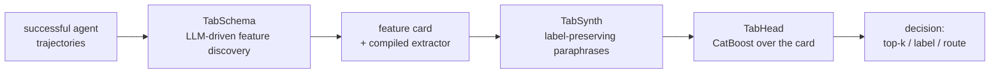

# TabAgent

**Replace an LLM agent's repeated closed-set decisions with a cheap classifier trained on the agent's own
successful runs.**

Agents call a frontier LLM again and again for decisions whose answer comes from a fixed set: which tools to
shortlist, which skill or application to use, which model or sub-agent to route to, whether to activate a
skill. TabAgent learns those decisions from the agent's execution traces and serves them from a tabular
classifier, with the surrounding agent left unchanged.

| | frontier-LLM decision | TabAgent head |
|---|---|---|
| latency per decision | seconds | milliseconds (~10³× lower) |
| cost per decision | cents | ~10⁻⁷ USD (~10⁵× lower) |
| quality | the reference | recovers essentially all tools the LLM used on successful runs (Recall@9) |

Numbers are from the paper, *TabAgent: Distilling LLM Agent Components into Cheap Classifiers*.

## How it works



1. **TabSchema** reads your agent's own logs and, with an LLM, proposes behavior-grounded features, writes and
   sandbox-tests the code that extracts them, and keeps only those a judge ensemble accepts. The output is a
   *feature card* plus a reusable, reviewed extractor. It runs once per agent and catalog.
2. **TabSynth** adds deterministic, label-preserving paraphrases of the free-text state where trajectories are
   scarce.
3. **TabHead** scores every candidate of a decision in one pass (CatBoost), with an optional confidence gate that
   defers uncertain decisions back to the original LLM.

## Install

```bash
pip install tabagent                    # core: tables, TabSynth, TabHead, evaluation
# until the PyPI release: pip install "tabagent @ git+https://github.com/dolev31/TabAgent"
pip install "tabagent[tabschema]"       # + onboarding from agent logs (OpenAI-compatible LLM client)
pip install "tabagent[embed]"           # + e5 context-candidate similarity features
pip install "tabagent[serve]"           # + HTTP decision service
```

## Try it

```bash
git clone https://github.com/dolev31/TabAgent && cd TabAgent
pip install -e ".[embed]"
python examples/01_quickstart_skillsbench.py
```

The first run downloads the pinned SkillsBench release (about 6 MB, SHA-256 verified), then runs the paper's
five-fold task-level cross-validation on CPU (about seven minutes on a laptop). It prints P@R ≈ 0.79 and
Recall@9 ≈ 0.90 with 95% bootstrap intervals, then the five skills TabAgent would hand the agent for one task.
[docs/reproducing.md](reproducing.md) compares this number with the paper's.

| Example | What it shows | Needs |
|---|---|---|
| [01_quickstart_skillsbench.py](https://github.com/dolev31/TabAgent/blob/main/examples/01_quickstart_skillsbench.py) | the paper's components on a public benchmark, cross-validated | CPU; network on first run |
| [02_bring_your_own_table.py](https://github.com/dolev31/TabAgent/blob/main/examples/02_bring_your_own_table.py) | scikit-learn estimators on your own decision table | CPU |
| [03_onboard_agent_logs.py](https://github.com/dolev31/TabAgent/blob/main/examples/03_onboard_agent_logs.py) | onboarding a decision from your own agent logs | an LLM API key |
| [04_deploy.py](https://github.com/dolev31/TabAgent/blob/main/examples/04_deploy.py) | live decisions in-process, the HTTP service, a tool filter in front of your LLM | a saved head (from 03) |
| [05_tau2_cross_agent_transfer.py](https://github.com/dolev31/TabAgent/blob/main/examples/05_tau2_cross_agent_transfer.py) | training on one agent's traces and deploying on another's (paper Table 2) | CPU; network on first run |

## Three ways to use it

### 1. You have agent logs and an LLM key

```bash
export OPENAI_API_KEY=...        # or OPENAI_BASE_URL for any OpenAI-compatible server, or ANTHROPIC/GEMINI keys
tabagent components ./agent_logs                              # which decisions can be replaced?
tabagent onboard ./agent_logs --decision ToolShortlist --dry-run   # what it will process and cost
tabagent onboard ./agent_logs --decision ToolShortlist --out ./my_head
tabagent serve ./my_head --port 8077
```

```python
import tabagent

head = tabagent.onboard("./agent_logs", decision="ToolShortlist", max_cost_usd=50)
print(head.report)  # grouped cross-validation vs BM25/e5 baselines, latency, cost per decision
head.save("my_head")
head.decide(prefix, candidates, k=5)  # {"choice": [...], "scores": {...}, "confidence": ..., "defer": ...}
```

Supported log formats are detected automatically: OpenAI / Anthropic / LangChain tool-call message logs,
τ²-bench results, CUGA trajectories, and generic JSON with a `steps` list. Trajectories are sent to your LLM
provider during onboarding; pass `redact=` to scrub them first.

### 2. You have a table of decisions (scikit-learn API)

```python
from sklearn.model_selection import GroupKFold, cross_val_score
import tabagent
from tabagent import TabAgentRanker

# one row per (decision, candidate); y = 1 if the agent chose the candidate
ranker = TabAgentRanker(group_col="task_id", candidate_col="tool")
ranker.fit(X, y)  # infers the card, picks TabSynth and the prior by nested validation
ranker.rank(X_new, k=5)  # top-5 candidates per decision
cross_val_score(ranker, X, y, groups=X.task_id, cv=GroupKFold(5), scoring=tabagent.scorer("p@r"))
print(ranker.report(X, y))
```

`TabAgentClassifier` handles single-label decisions, `TabAgentRouter` handles routing (pick the arm with the
highest predicted success). `tabagent.pointwise()` turns one-row-per-decision logs into this layout.

### 3. Full control: the paper's components

```python
from tabagent import FeatureCard, TabAgent, TabHead, TabSynth, cross_validate, datasets

table = datasets.load("skillsbench/skill-select", download=True)  # rebuilt from the pinned public release
card = datasets.card("skillsbench/skill-select")
agent = TabAgent(card, head=TabHead("ranking"), synth=TabSynth(k=2))
res = cross_validate(agent, table, folds=datasets.folds("skillsbench/skill-select"))
print(res.summary(["p@r", "recall@9"]))
```

## Reproducing the paper

The release reproduces the following from public data: τ²-bench (cross-backbone transfer and per-domain
shortlisting), SkillsBench (skill selection and gating), Mind2Web (operation and element selection),
LLMRouterBench (model routing, opt-in license acknowledgement) and AppWorld sub-agent routing (data obtained
through AppWorld's official CLI). See [docs/reproducing.md](reproducing.md) for each paper cell, the command
that recomputes it, and the value it produces. The AppWorld tool-shortlisting results and the in-loop hot swap
use the CUGA agent's own trajectories, which are not released; the CUGA trajectory adapter is included, so the
pipeline can be rerun on your own CUGA traces. The OAK and BPO benchmarks are public; loaders for them are not
included yet.

## Documentation

| Guide | Covers |
|---|---|
| [Concepts](concepts.md) | the decision table, the four decision kinds, leakage safety, the evaluation protocol |
| [Components](components.md) | TabSchema, TabSynth and TabHead in detail |
| [Onboard an agent](onboarding.md) | log formats, privacy and cost controls, reviewing the generated extractor |
| [Bring your own table](bring_your_own_data.md) | the scikit-learn estimators and automatic recipe selection |
| [Deploy](deployment.md) | saved heads, the HTTP service, the tool filter, the confidence gate |
| [Datasets](datasets.md) | every public dataset, its pinned source, license and the paper result it backs |
| [Reproducing the paper](reproducing.md) | each paper cell, the command that recomputes it, paper vs released values |

`make docs` builds these pages as a searchable site (mkdocs-material).

## Data policy

TabAgent ships no benchmark data and no agent trajectories. Public datasets are downloaded from their upstream
releases at pinned revisions and verified by SHA-256; licenses are listed in [NOTICE](https://github.com/dolev31/TabAgent/blob/main/NOTICE).

## Citation

```bibtex
@article{tabagent2026,
  title   = {TabAgent: Distilling LLM Agent Components into Cheap Classifiers},
  year    = {2026},
  note    = {Author list and venue are added at publication}
}
```

## License

Apache-2.0.
