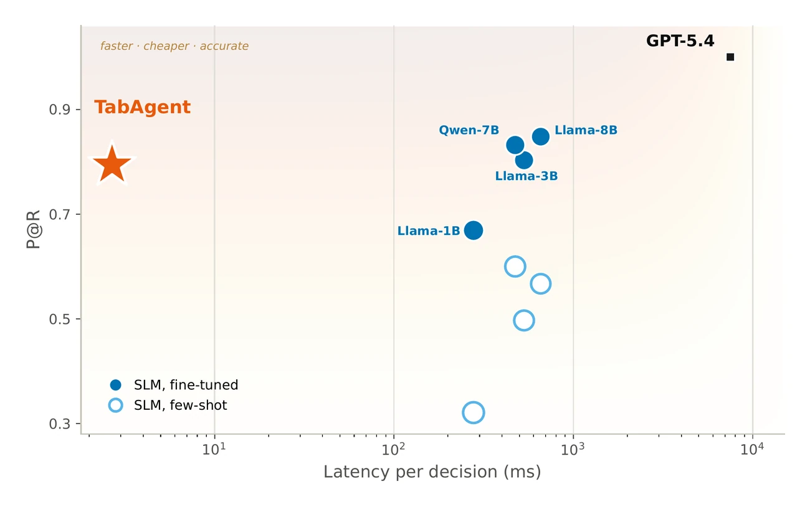

<!-- The hero, the explainer and the animated pipeline are in docs/overrides/home.html. Every number below is listed
     in docs/claims-map.md with its place in the paper. -->

<p class="ta-eyebrow">Results at a glance</p>

## One classifier pass instead of a frontier-LLM call { #results-at-a-glance }

<p class="ta-section-lead">AppWorld tool shortlisting, per decision: TabAgent's head against the GPT-5.4 shortlister it replaces. From the paper.</p>

<div class="ta-stats">
  <div class="ta-stat ta-stat--head">
    <div class="ta-stat__label">Latency per decision</div>
    <div class="ta-stat__value">2.682<small>&nbsp;ms</small></div>
    <div class="ta-stat__compare">vs 7.50&nbsp;s for the GPT-5.4 shortlister, more than 10³× lower</div>
  </div>
  <div class="ta-stat ta-stat--head">
    <div class="ta-stat__label">Cost per decision</div>
    <div class="ta-stat__value">$2.0×10<sup>−7</sup></div>
    <div class="ta-stat__compare">vs $0.052 for the GPT-5.4 shortlister, about 10⁵× lower</div>
  </div>
  <div class="ta-stat ta-stat--schema">
    <div class="ta-stat__label">Recall@9</div>
    <div class="ta-stat__value">92–100</div>
    <div class="ta-stat__compare">of the tools GPT-5.4's successful runs used, across five AppWorld apps</div>
  </div>
  <div class="ta-stat ta-stat--synth">
    <div class="ta-stat__label">Trajectories needed</div>
    <div class="ta-stat__value">118</div>
    <div class="ta-stat__compare">successful runs reach 90% of the head's full-pool P@R on AppWorld</div>
  </div>
</div>

<div class="ta-results" markdown>

| Decision | Benchmark | Metric | Best baseline | TabAgent | Reproducible here |
|---|---|---|---:|---:|:---:|
| Tool shortlisting | AppWorld, five apps | P@R | 56–92 | **66–96** | traces not released |
| Tool shortlisting | τ²-bench, three domains, 38 tools | P@R | 42 | **78** | ✓ |
| Skill shortlisting | SkillsBench, 195 skills | P@R | 74 | **80** | ✓ |
| Application selection | AppWorld, multi-label | macro&#8209;F1 | 92 | **97** | traces not released |
| Operation selection | Mind2Web, three-way | macro&#8209;F1 | 84 | **92** | ✓ |
| GUI element selection | Mind2Web, three domains | R@3 | 15–23 | **68–74** | ✓ |
| Model routing | LLMRouterBench, 12 models | route@1 | 70 | **71**&nbsp;(on&nbsp;par) | ✓ opt-in download |

</div>

??? note "How to read this table"

    Percentages from the paper's Table 1 and, for AppWorld, its full per-method table. TabAgent is the better of
    its real-only and +synth variants. Best baseline is the strongest of BM25, DSR (zero-shot and fine-tuned; on
    AppWorld also fine-tuned on the same TabSynth rows, where TabAgent's lead is significant only on Gmail) and the
    few-shot LLM in each row; on model routing it is the best single model applied to every task. A fine-tuned 8B
    small LLM, a reference at about 10²–10⁴× TabAgent's cost, is excluded as in the paper; it scores higher on four
    of the five AppWorld apps. The AppWorld rows use the CUGA agent's own trajectories, which are not released. The
    paper's table also covers the OAK and BPO enterprise benchmarks, where the small trajectory pools leave TabAgent
    behind or level with the best baseline, and sub-agent routing and skill gating, where it is on par with the best
    fixed default. [Reproducing the paper](reproducing.md) recomputes every public row.

    The reproducible rows run on the feature cards bundled with each public dataset, not on a new TabSchema run, so
    reproducing them calls no LLM. A card is *frozen* when its feature list was taken from the paper's experiment
    code for that benchmark and fixed, every feature recomputed by the release's code (a few frozen cards are
    variants; each card's `provenance` note says how), and *hand-authored* when it was written for the release from
    the paper's description of the benchmark's features (`provenance.kind` in each card). The released TabSchema
    implementation has not yet been validated against a paper number.

<p class="ta-eyebrow">Quick start</p>

## Install, onboard, decide { #quick-start }

<div class="ta-quick" markdown>

=== "pip"

    ```bash
    pip install tabagent                # core: tables, TabSynth, TabHead, evaluation
    pip install "tabagent[tabschema]"   # + onboarding from agent logs (OpenAI and OpenAI-compatible LLMs)
    pip install "tabagent[llm]"         # + Anthropic, Gemini and other providers through LiteLLM
    pip install "tabagent[serve]"       # + the HTTP decision service
    ```

    Python 3.10 to 3.13. Until the PyPI release, install from GitHub:
    `pip install "tabagent @ git+https://github.com/dolev31/TabAgent"`.

=== "CLI"

    ```bash
    export OPENAI_API_KEY=...                                     # the LLM TabSchema calls
    tabagent scan ./agent_logs                                    # which LLM calls are worth replacing?
    tabagent onboard ./agent_logs --decision ToolShortlist --dry-run   # what it will process and cost
    tabagent onboard ./agent_logs --decision ToolShortlist --out ./my_head
    tabagent serve ./my_head --port 8077                          # POST /decide
    ```

=== "Python"

    ```python
    import tabagent

    head = tabagent.onboard("./agent_logs", decision="ToolShortlist")
    print(head.report)  # grouped cross-validation vs BM25 and chance, latency, cost per decision
    head.save("my_head")
    head.decide(prefix, candidates, k=5)  # {"candidates", "scores", "confidence", "deferred", "error"}
    ```

=== "Your own table"

    ```python
    from tabagent import TabAgentRanker

    # one row per (decision, candidate); y = 1 if the agent chose the candidate
    ranker = TabAgentRanker(group_col="task_id", candidate_col="tool")
    ranker.fit(X, y)  # infers the card, picks TabSynth and the prior by nested validation
    ranker.rank(X_new, k=5)  # top-5 candidates per decision
    ```

=== "Reproduce"

    ```bash
    git clone https://github.com/dolev31/TabAgent && cd TabAgent
    pip install -e ".[embed]"
    python examples/01_quickstart_skillsbench.py   # P@R ≈ 0.80 on SkillsBench, CPU, a few minutes
    ```

</div>

<!-- named -->
<p class="ta-colab" markdown>Or run the quickstart in your browser: [{ width="117" height="20" }](https://colab.research.google.com/github/dolev31/TabAgent/blob/main/notebooks/quickstart.ipynb)</p>
<!-- /named -->

<p class="ta-eyebrow">Use it in your agent</p>

## Onboard, serve, hot-swap { #use-it-in-your-agent }

<div class="ta-uses" markdown>

<div class="ta-use" markdown>

### Onboard from logs

`tabagent onboard` reads the agent's own logs (OpenAI, Anthropic, LangChain, τ²-bench, CUGA or generic JSON),
discovers the features with TabSchema, and saves a head with a reviewed, hash-pinned extractor.

[Onboard your agent](get-started/onboard-your-agent.md)
</div>

<div class="ta-use" markdown>

### Serve it

`tabagent serve` answers `POST /decide` from warm, sandboxed workers, defers a decision whose extraction runs late,
and exposes readiness, Prometheus metrics and feature-drift monitoring.

[Deploy and operate](guides/production-runbook.md)
</div>

<div class="ta-use" markdown>

### Hot-swap the LLM call

`ToolFilter` sends your tool-calling LLM only the tools the head shortlists, and the full list whenever the head
defers. The surrounding agent is unchanged.

[Hot-swap into an agent](guides/hot-swap-into-an-agent.md)
</div>

</div>

```python
from tabagent.integrations.openai_tools import ToolFilter

tool_filter = ToolFilter("my_head", k=7)  # or the URL of a `tabagent serve` service
session = tool_filter.session(task={"instruction": goal})  # one per conversation
client.chat.completions.create(model=..., messages=messages, tools=session(messages, tools))
```

<p class="ta-eyebrow">What the paper finds</p>

## The representation, not the model { #what-the-paper-finds }

<div class="ta-findings" markdown>

<figure class="ta-figure" markdown="span">
  { loading=lazy decoding=async width="1300" height="814" }
  <figcaption>Per-decision latency (x, log ms) against shortlisting quality P@R (y) on AppWorld. TabAgent (star) is the fastest and cheapest point while remaining near the top on quality; filled circles are fine-tuned small LLMs, open circles the same models few-shot. Figure from the paper.</figcaption>
</figure>

<div markdown>

Across three decision families and seven agent benchmarks:

- **Set retrieval.** On AppWorld tool shortlisting, TabAgent recovers essentially all of the tools the GPT-5.4
  shortlister used on its successful runs (Recall@9) at far lower latency and cost.
- **Classification and policy.** It ranks first on the classification decisions and is on par with a strong
  fixed default on the harder routing and gating decisions, where a costly generative router does worse.
- **Representation, not model.** A discriminative head over raw text or embeddings alone collapses; the
  trace-derived features make it accurate.
- **In the loop.** Placed on a live agent's critical path, TabAgent drives AppWorld tasks to completion about
  as often as the GPT-5.4 shortlister it replaces.
- **Few traces.** The head reaches 90% of its full-pool P@R from 118 successful trajectories on AppWorld and
  from 37 to 51 on the four τ²-bench agents.

</div>

</div>

<p class="ta-eyebrow">Go deeper</p>

## Documentation { #guides }

<div class="grid cards ta-guides" markdown>

-   :material-rocket-launch-outline: [Get started](get-started/index.md)

    Install, a five-minute quickstart, onboard your agent, and the core ideas.

-   :material-book-open-variant-outline: [Guides](guides/index.md)

    Onboard from logs, bring your own table, evaluate a head, deploy and serve, hot-swap into an agent.

-   :material-lightbulb-on-outline: [Concepts](concepts/index.md)

    The three phases, decision kinds, per-candidate features, leakage safety, the confidence gate.

-   :material-code-braces: [API reference](reference/index.md)

    Signatures, parameters and examples from the docstrings, and every command-line flag.

-   :material-flask-outline: [Reproducing the paper](reproducing.md)

    Each paper cell, the command that recomputes it, paper vs released values.

-   :material-database-outline: [Datasets](datasets.md)

    Every public dataset, its pinned source, license and the paper result it backs.

-   :material-history: [Changelog](changelog.md)

    What changed in each release.

-   :material-console: [Examples](https://github.com/dolev31/TabAgent/tree/main/examples)

    Five runnable scripts, from the public-benchmark quickstart to cross-agent transfer.

</div>

<p class="ta-eyebrow">The paper</p>

## Abstract

<div class="ta-abstract" markdown>

Agentic systems chain LLM calls to make closed-set decisions: choosing from a fixed candidate set, as in skill
selection, tool shortlisting, application selection, and routing. These repeated frontier-model calls dominate
per-task latency and cost. We show such decisions need not be made by a language model at all: a compact
discriminative head, trained on the agent's own successful execution traces, can replace the generative one while
leaving the surrounding agent intact. TabAgent has three parts. (i) **TabSchema** extracts schema, state, and
dependency features from trajectories. (ii) **TabSynth** adds schema-aligned synthetic rows where trajectory coverage
is thin. (iii) **TabHead**, a cheap tabular classifier, scores candidates in a single pass. Changing only the label
space, we test TabAgent as a drop-in replacement for the frontier-LLM heads (e.g., GPT-5.4) across three decision
families and seven agent benchmarks. On tool shortlisting it recovers essentially all of the tools the GPT-5.4
shortlister used on its successful runs (Recall@9), at 99.96% lower latency and 99.9996% lower cost per call
(∼10³× and ∼10⁵×). It also ranks first on the classification decisions and is on par with a strong fixed default on
the harder routing and gating decisions at far lower latency and cost, where a costly generative router does worse.
Across these tasks, the gains come from the representation, not the model: a discriminative head over raw text or
embeddings alone collapses, and trace-derived features make it accurate.

</div>

<!-- named -->
<p class="ta-abstract__source">The paper on arXiv: <a href="https://arxiv.org/abs/2602.16429" data-goatcounter-click="paper">abstract page</a> · <a href="https://arxiv.org/pdf/2602.16429" data-goatcounter-click="paper-pdf">PDF</a>. Its first version (v1, February 2026) carries the paper's earlier title, <em>TabAgent: A Framework for Replacing Agentic Generative Components with Tabular-Textual Classifiers</em>.</p>
<!-- /named -->

## Key terms

<dl class="ta-terms">
<div><dt>Closed-set decision</dt><dd>A decision inside an agent's execution whose answer is selected from a fixed, bounded set of candidates: which skill to invoke, which tool to call next, which application to route to, or which sub-task to gate.</dd></div>
<div><dt>Tool shortlisting</dt><dd>The task of picking a small subset from a catalog of hundreds to thousands of tools, where a tool is any externally callable capability (API endpoint, function, or GUI operation) with a typed schema and observable outputs.</dd></div>
<div><dt>Feature card</dt><dd>The tabular layout TabAgent learns from, with one row per (context, candidate) pair and one column per behavior-grounded feature.</dd></div>
<div><dt>TabSchema</dt><dd>An orchestrated agentic system that proposes features, implements them as executable trace-extraction code, and keeps only those a judge ensemble agrees are decision-relevant.</dd></div>
<div><dt>TabSynth</dt><dd>A schema-aligned augmentation module: a deterministic, rule-based paraphraser that rewrites the free-text state of an existing training row while copying the candidate, the label, and every schema, state, and dependency feature verbatim.</dd></div>
<div><dt>TabHead</dt><dd>The classifier that scores each (context, candidate) pair over the TabSchema feature card in a single pass. It is CatBoost in every main-paper result.</dd></div>
<div><dt>P@R (R-precision)</dt><dd>The share of a task's ground-truth tools that appear in the top R of the ranking, where R is the task's relevant-set size, averaged over tasks. It equals Recall@R and captures completeness.</dd></div>
<div><dt>Recall@k</dt><dd>The share of a task's ground-truth tools recovered in the top k of the ranking, averaged over tasks: recovery at a fixed budget.</dd></div>
</dl>

<p class="ta-eyebrow">FAQ</p>

## Questions

<div class="ta-faq" markdown>

??? question "Can a small classifier replace an LLM for tool selection in an agent?"

    For closed-set decisions an agent makes repeatedly, the paper shows it can. TabAgent trains a CatBoost classifier
    on the agent's own successful traces. On AppWorld tool shortlisting it recovers essentially all of the tools
    GPT-5.4's successful runs used (Recall@9 of 92 to 100 across five apps) at 2.682 ms and $2.0×10⁻⁷ per decision,
    against 7.50 s and $0.052 for the GPT-5.4 shortlister.

??? question "What is TabAgent?"

    TabAgent is a framework that replaces a generative decision head in a running LLM agent, such as a tool
    shortlister or a router, with a compact classifier trained on the agent's own successful execution traces.
    TabSchema turns the traces into a tabular feature card, TabSynth adds paraphrased rows where coverage is thin, and
    TabHead (CatBoost) scores every candidate in one pass. The surrounding agent is left unchanged.

??? question "What exactly does TabAgent learn from?"

    From the agent's own successful execution traces. TabSchema turns them into a tabular feature card: each row is a
    (task context, candidate tool) pair, each column a behavior-grounded feature (for example, the agent's current
    thought, the step index, or whether the candidate has co-occurred with other tools in similar traces), and the
    label is whether the successful trajectory used the candidate. TabAgent learns the decision boundary of the
    generative head from these rows and runs that boundary as a single-pass classifier in place of the LLM.

??? question "Which decisions can TabAgent replace?"

    Closed-set decisions, whose answer comes from a fixed set of candidates. The paper covers three families across
    seven benchmarks: set retrieval (tool and skill shortlisting on AppWorld, τ²-bench, OAK, BPO and SkillsBench),
    classification (application selection on AppWorld, operation and GUI element selection on Mind2Web), and policy
    or reward decisions (sub-agent routing on AppWorld, model routing on LLMRouterBench, and skill gating on
    SkillsBench).

??? question "Does the classifier head matter?"

    Little. With the skill-selection feature card held fixed, heads from classical trees to tabular foundation
    models such as TabPFN and TabSTAR reach useful and comparable P@R on skill selection, and every head collapses
    to P@R 0.10 to 0.21 without the card. The gains come from the trace-derived representation, not the model, which is why one
    lightweight CatBoost head serves every decision family in the paper.

??? question "Does TabSynth always help?"

    Not always. On AppWorld, TabSynth lifts TabAgent P@R by 23% on average, concentrated in domains
    where limited trajectory coverage causes the shortlister to miss required selections (SimpleNote +55%,
    Phone +36%). It is not universally positive: on Spotify it lowers P@R (70 → 61), which the paper attributes to a small
    trajectory pool and strong lexical cues that turn paraphrase diversity into noise rather than coverage. The paper
    therefore applies +synth per card and reports the head that wins.

??? question "How does TabAgent hold up as the number of candidates grows?"

    Its margin widens as the candidate set grows. As the candidate-set size K grows, every LLM adaptation regime
    (generative SFT, cross-encoder, and few-shot) degrades sharply on both skill selection and Mind2Web element
    selection, while the TabAgent classifier follows a shallow power law (R² ≥ 0.97) and stays highest at every
    measured K. TabAgent scores each candidate against fixed trace-derived features, so the per-candidate cost is
    constant and the total cost grows only linearly in the number of candidates, unlike an LLM that must reason over
    the entire option list in-context, whose prompt grows with the catalog and can exceed 100K tokens for the
    closed-set options alone.

??? question "How many trajectories does TabAgent need?"

    On AppWorld, TabHead reaches half of its full-pool P@R from 8 successful trajectories and 90% from 118. On the
    four τ²-bench agents it reaches 90% from 37 to 51. Onboarding therefore costs tens to low hundreds of successful
    traces rather than thousands. With no trajectories for a domain it cannot be applied, since there is nothing to
    mimic.

??? question "What happens when the agent's prompt or base model changes?"

    When the upstream agent's behavior shifts (a new prompt, a new base model) but its trace schema is unchanged,
    only TabHead is refit on the new traces, which takes about 45 seconds on CPU, so drift adaptation does not
    require a re-engineering pass. A change that alters the feature schema itself requires re-running the one-time
    TabSchema and TabSynth onboarding.

??? question "Does replacing the shortlister hurt task success in a live agent?"

    In the paper's live hot-swap on 24 held-out cross-application AppWorld tasks, with the CUGA agent driven by
    GPT-5.4 in both arms, TabAgent reached 27.1% Pass@1 against 29.2% for the GPT-5.4 shortlister. The paired
    difference of -2.1 points has a 95% bootstrap CI of [-18.8, +16.7], which includes zero. The two configurations
    agree on the pass-or-fail verdict for 79% of tasks.

??? question "Does a model trained on one agent's traces work for another agent?"

    Within one architecture, yes. On τ²-bench, four ReAct agents share one scaffold and differ only in the LLM
    backbone. Training on one agent's traces and testing on another's costs about 3.1 points of P@R on average
    (own-agent mean 0.766, cross-agent mean 0.735). The paper states this is transfer within an architecture, not
    evidence that TabAgent is architecture-agnostic.

??? question "When should the LLM still make the decision?"

    When the domain has no trajectory pool, when the agent architecture changes, and when the head is unsure.
    TabHead's confidence flags its own errors at AUROC 0.88, so a confidence gate can defer low-confidence decisions
    to the original LLM. The paper does not claim TabAgent beats the LLM everywhere: the frontier model is retained
    where it still earns its cost.

</div>

<!-- named -->
<p class="ta-eyebrow">Cite</p>

## Citation

If you use TabAgent, please cite the paper:

<div class="ta-bibtex" data-goatcounter-click="bibtex" data-goatcounter-title="BibTeX" markdown>

```bibtex
@misc{levy2026tabagent,
  title  = {TabAgent: Distilling LLM Agent Components into Cheap Classifiers},
  author = {Levy, Ido and Shlomov, Segev and Yaeli, Avi and Mashkif, Nir and Adi, Asaf and
            Goldstein, Yinon and Shapira, Eilam and Choshen, Leshem},
  year   = {2026},
  eprint = {2602.16429},
  archivePrefix = {arXiv},
  primaryClass  = {cs.CL},
  doi    = {10.48550/arXiv.2602.16429},
  url    = {https://arxiv.org/abs/2602.16429}
}
```

</div>

<!-- /named -->
